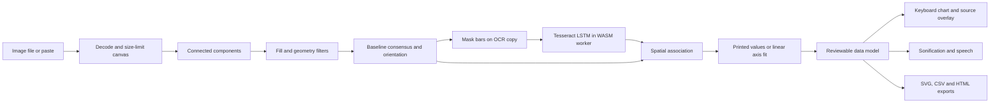

# Engineering notes

## Data flow

## Why these choices

Tesseract supplies pretrained image-to-text intelligence with spatial boxes and confidence information. Keeping it local eliminates external inference setup and image transfer. The model is used for text recognition, not credited with bar detection. Detection, geometric matching, calibration, summaries, and sonification are original deterministic code around it.

Connected components use an estimated corner background and color-distance gates. Rectangles must pass a fill-density threshold and size filters. A shared bottom edge suggests vertical bars; a shared left edge suggests horizontal bars. Bars with consistent thickness are grouped. This deliberately targets a tractable chart family instead of claiming general vision capability.

We erase detected bar interiors on a copy of the input before OCR. The original remains available for inspection. Spatial gates bind printed numbers near bar endpoints and labels near the category axis. The nearest label row excludes chart footnotes.

If direct values are missing, numeric axis ticks define a least-squares linear mapping from pixel location to chart units. A residual gate rejects inconsistent fits. This does not prove that a chart uses a linear axis; logarithmic charts remain out of scope. A mixed set of known/unknown absolute values is converted entirely to relative bar sizes to avoid silently mixing units.

## Sound and semantics

Pitch follows `220 × 4^(value / seriesMaximum)`, a two-octave range. Each tone has a short gain envelope to avoid abrupt clicks. Sonification is complemented by exact numeric labels, a semantic table, and OS speech. Audio requires user action; it never autoplays.

The chart uses roving tabindex with arrow/Home/End navigation and descriptive button labels. SVG exports embed title/description; HTML reports include a visible summary and semantic table. Patterns and values provide alternatives to color. All generated text is escaped. CSV labels that could be interpreted as spreadsheet formulas are prefixed with an apostrophe.

## Boundaries and privacy

Images are decoded with browser APIs, capped at 12 MB and 45 million pixels, then reduced to at most 1,400 pixels on the long edge for uploaded inputs. Sample fixtures retain their authored resolution. No pixel data enters a remote inference API. Assets, fonts, model weights, and WASM are local to the served origin. State exists in tab memory; Tesseract may cache model weights in IndexedDB.

No telemetry, user accounts, database, generative LLM, or custom training are involved in the application. The hosting platform may enforce its own access controls. This is a static browser app.
